<!-- CTB coronagraph diffraction-model progress deck, v8 2026-11-02.
     Build: python3 make_brief_slides.py deck_ctb.md
     Edit copy for Dave: deck_ctb_edit.pptx beside deck_ctb.pptx (ignored by git;
     the baseline of the same build is deck_ctb_edit_base.pptx).
     Sources: bench_ctb/CTB_PROP_STATUS.md (sessions 4-14) + committed
     figures in THIS directory (mask families + leg fix + export, pol-ifo
     ab494ec..a060ef0/46d0bc6; DM layer + EFC, dev-candidate ea64552;
     physics layers + vector vortex, dev-candidate 29edb1d/9ea80e5+; the
     telescope slides from e2e stages 8-11, templates/80_end_to_end/e2e/
     s8_coronagraph.m, s9_diffraction.m, s10_sensing.m, s11_cycles.m;
     figures ctb_e2e_*.png copied from their products (s9_fields,
     ctb_efc_e2e_coupled, s10_probe, s11_cycles, s8_shroud) or drawn by
     ctb_e2e_figures.m (ctb_e2e_views, ctb_e2e_walk); the numbers from
     s9/s10/s11_report.txt at GridSrfOrder= 3, 2026-11-02, and
     PLAN_CONSOLIDATION 3a).  v8: slide numbers dropped from the titles,
     the text tightened, two new telescope slides (the views, the station
     walk), sub-bullets ("  - ") rendered by make_brief_slides.py.
     Style: doc/DECK_STYLE.md + STYLE_REPORTS.md section 5.             -->

# The Coronagraph Testbed – and Telescope
End-to-end diffraction on an all-reflective testbed — eight off-axis parabolas, two deformable mirrors — then added to a 4 meter aperture telescope
D. C. Redding with Claude Code — 2 November 2026.
Model + drivers: MACOS_resources dev-candidate, mmacos/templates/30_instruments/bench_ctb (committed, with status record); the telescope model in templates/80_end_to_end/e2e (stages 8 to 11).

## Coronagraph Testbed (CTB) bench and model | Two prescriptions, one physical train; every mask plane bracketed by its own exit-pupil reference sphere
::: left
- The bench: 8 off-axis parabolas, 2 deformable mirrors (DM1 the aperture stop, 21.2 mm beam), apodizer and Lyot at pupil images, focal-plane mask and field stop at focus images, camera at the final focus. Geometrically diffraction-limited (0.0014 λ).
- Two propagation prescriptions on the same optics:
  - compact, 31 elements: one plane-to-plane leg DM1→DM2, a four-surface mask block at each focus, far-field to the camera;
  - full, 44 elements: every inter-optic leg propagated.
- The four-surface mask block: flat return at the mask plane, exit-pupil sphere carrying the first half-propagation, the mask plane carrying the second half, the same sphere again. Equal sphere distances to all digits make the block transparent with no mask applied.
- Both load pre-aligned with a centered point image; chief-ray intersections match the geometric bench to 10⁻¹³ at every optic.
::: right
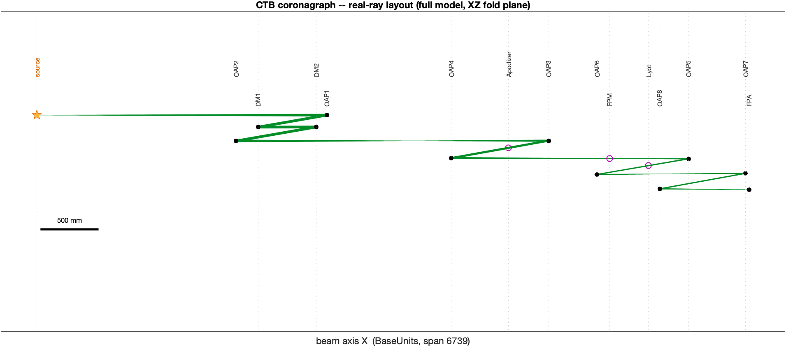{h=3.1}
~ Masks are applied in MATLAB by multiplying the propagated complex field at the passive mask planes: the prescription carries the propagation, the script carries the masks.

## Validation: MACOS vs. PROPER | The new propagation step reproduces PROPER exactly; the two models differ only where their fidelity differs
::: left
- The one step the earlier PROPER campaign never tested, the through-focus half-propagation from the exit-pupil sphere to the mask plane, cross-checked against MATLAB PROPER at matched sampling:
  - focal-plane pixel pitch ratio 1.0000, peak-normalized correlation 1.000000, centroid offset 0.000 px.
- The half-propagation pair round-trips to machine precision with no mask; the reported focal pitch matches λR/(N·dx) to ratio 1.0000. An earlier inconsistent pitch traced to the superseded block construction, not the engine.
- Found and fixed: the compact DM1→DM2 leg propagated 400 mm for a 500 mm spacing, with its end plane on the wrong side of DM1. Two independent fixes agree to every digit; every number here is from the corrected prescription.
- Compact vs full: bare images agree to 0.9989 correlation, encircled energy within 0.3%; with the coronagraph in, the suppression gap is 1.76× (was 2.6×), the mirror-to-mirror diffraction the compact model omits. PROPER remains the arbiter for both.
::: right
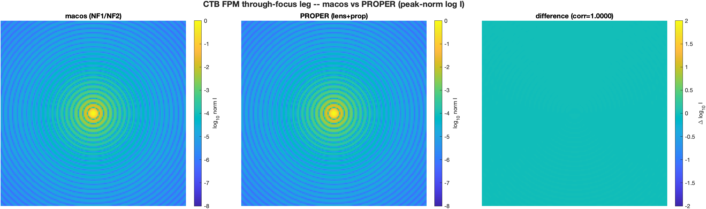{h=2.3}
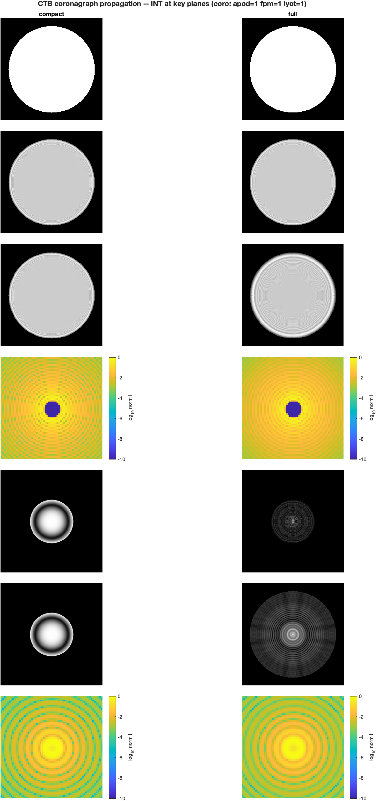{h=2.2}

## Coronagraph performance | A half-pixel centering fix, 4× finer sampling and a mask sweep bought 16× in contrast
::: left
- Centering: the mask builders sat half a pixel off the focus pixel, so every occulter leaked asymmetrically. Fixed by shared mask builders centered on the focus pixel; the vortex gained the most.
- Sampling: the camera grid moved from 2.0 to 4.0 px per λ/D (model size 1024, zero-padding only), resolving clean symmetric rings.
- Mask sweep over the literature's ranges (occulter 1–3 λ/D, Lyot 75–90%): pure contrast pushes to the sweep edges, so throughput is recorded beside contrast.
  - A widened sweep found a robust interior null at occulter 2.70 λ/D, a diffraction resonance of this bench present at both samplings.
  - Lyot 0.50 is the shipped default (25% throughput; the Lyot radius sets the throughput).
- Net: dark-zone mean 4.6×10⁻⁶ → 2.9×10⁻⁷ (16×); suppressed peak 1.9×10⁻⁵ → 1.4×10⁻⁶. Shaped masks (next slides) go three decades further.
::: right
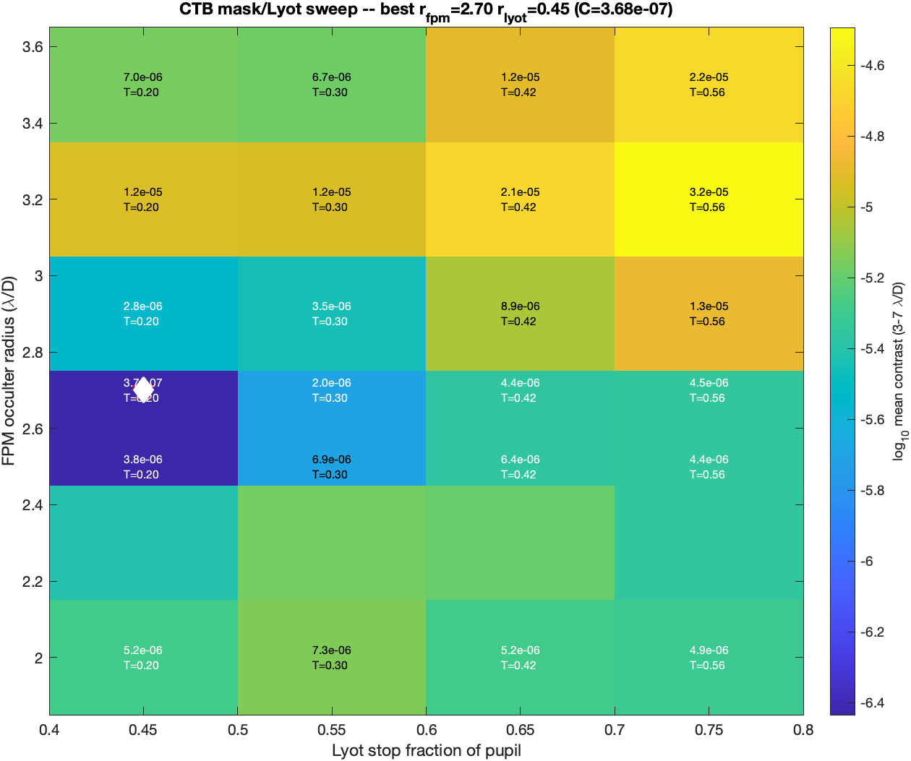{h=2.25}
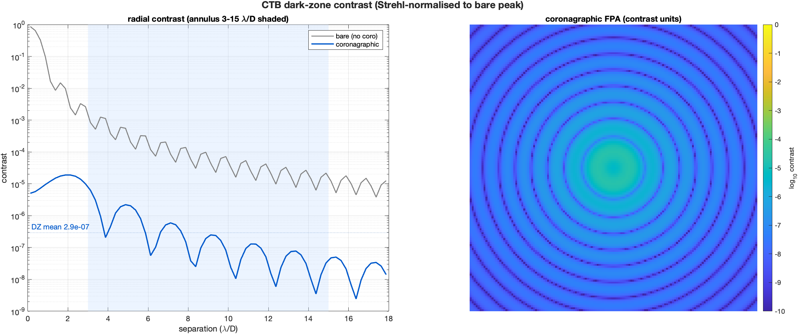{h=2.2}

## A planet in the dark zone, and a finite band | Each run surfaced a modeling rule now on record
::: left
- Companion injection: the focal-plane window method does not displace a companion here. The alignment rule that puts every vertex on the chief ray re-centers every grid on the tilted chief and lands the planet back under the occulter.
  - The working method: a pupil phase ramp on the complex field at DM1; k cycles across the pupil puts the companion at k λ/D against the fixed masks.
  - Verified: 6 λ/D commanded, 5.98 measured; at flux ratio 10⁻³ the difference panel recovers it cleanly.
- Finite bandpass: wavelengths summed incoherently after resampling each point image onto one physical detector grid. The far-field step re-grids per wavelength, so a naive array sum cancels chromaticity (the first attempt read exactly zero chromatic effect; the trap is documented).
  - Fixed-size occulter over a 10% band: the deep 2.70 λ/D null degrades 2.1×.
  - A mask scaled with wavelength confirms the machinery adds no chromatic error of its own.
::: right
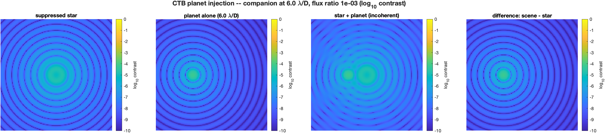{h=2.25}
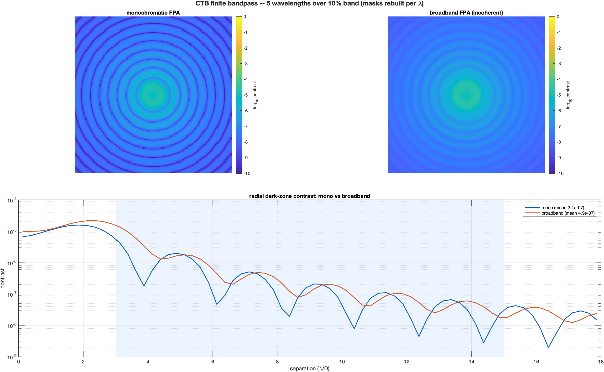{h=2.2}

## The standard mask families, head-to-head | Static masks before any DM control: the apodized-pupil Lyot is deepest; the pixel-averaged vortex second at three times its throughput
::: left
- Five mask families from the literature as reusable mask functions on the complex-mask interface, no engine work. Every formula from the source paper: secondary summaries get them wrong (band-limited masks are 1−sinc in amplitude, not intensity; the Lyot trims by 1−ε, not 1−2ε; the Roddier π-mask uses no apodizer).
- One grid, one annulus (3–15 λ/D), one normalization; the hard occulter re-scored on the same footing. Masks generated at 8× sub-pixel resolution and binned (area-average amplitude, complex-average phase).

| mask | static dark-zone mean | throughput |
| apodized-pupil Lyot (prolate) | 2.1×10⁻¹⁰ | 27% |
| vortex, matched Lyot | 1.4×10⁻⁸ | 81% |
| band-limited (4th order) | 2.7×10⁻⁸ | 36% |
| hard occulter | 2.5×10⁻⁷ | 25% |
| Roddier π-mask | 2.4×10⁻⁶ | 81% |
| dual-zone phase | 6.8×10⁻⁶ | 81% |
- The vortex row moved 21×: the direct-sampled mask's singular core, mis-phased pixels on the stellar core, had floored it at 2.9×10⁻⁷. Pixel-averaging cures it; charge 4 at a 0.50 stop reaches 6.6×10⁻¹¹, apodized-pupil-Lyot class at the same 25% throughput. Diagnosis in backup.
::: right
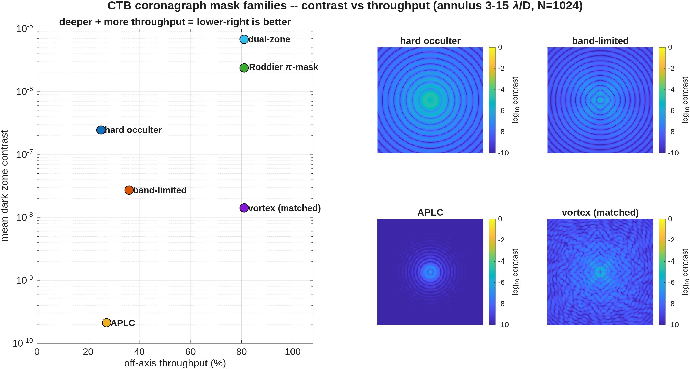{h=3.0}
- Mask alone above. With the two deformable mirrors closed-loop (control at N=512), the floors drop by decades:

| controlled chain | static | closed-loop floor |
| hard occulter, Lyot 0.50 (mono) | 2.9×10⁻⁷ | 3.8×10⁻⁹ |
| vortex charge 4, Lyot 0.60 (mono) | 1.7×10⁻⁸ | 6.8×10⁻¹⁵ |
| vortex charge 4, Lyot 0.60 (10% band, unpol.) | 2.2×10⁻⁸ | 2.0×10⁻¹¹ |
~ The hybrid Lyot coronagraph is deferred to the FALCO integration: its focal-plane mask is a product of the design loop, not a formula. Throughput = Lyot open area × apodizer transmission, an off-axis proxy, not an end-to-end planet throughput.

## The vortex against the Lyot stop | Charge 4 under-runs every fixed design at every throughput: 8.8×10⁻¹¹ at the band-limited mask's own 36%
::: left
- One mask, one dial: the vortex phase mask is fixed, only the Lyot fraction moves. Same grid, annulus and normalization as the head-to-head; the fixed-design markers are read from the committed comparison.
- The trade the cured core revealed: the rejected starlight piles just outside the geometric pupil edge, so contrast rises steeply as the stop opens toward it. Each fixed design is one point on a depth-for-throughput dial. Charge 4 runs about 4× deeper than charge 6 at every stop.
- Readings from the curve:
  - at the apodized-pupil Lyot's operating point, charge 4 with a 0.60 stop is deeper (8.8×10⁻¹¹ vs 2.1×10⁻¹⁰) at more throughput (36% vs 27%), with no apodizer to fabricate;
  - at the band-limited mask's 36%, 300× deeper;
  - at 81% throughput, 8.0×10⁻⁹, thirty times below the hard occulter at three times its throughput.
- Past 0.90 the leak ring arrives inside the stop (flux inside 0.1% → 1%); the useful range is 0.50–0.90.
::: right
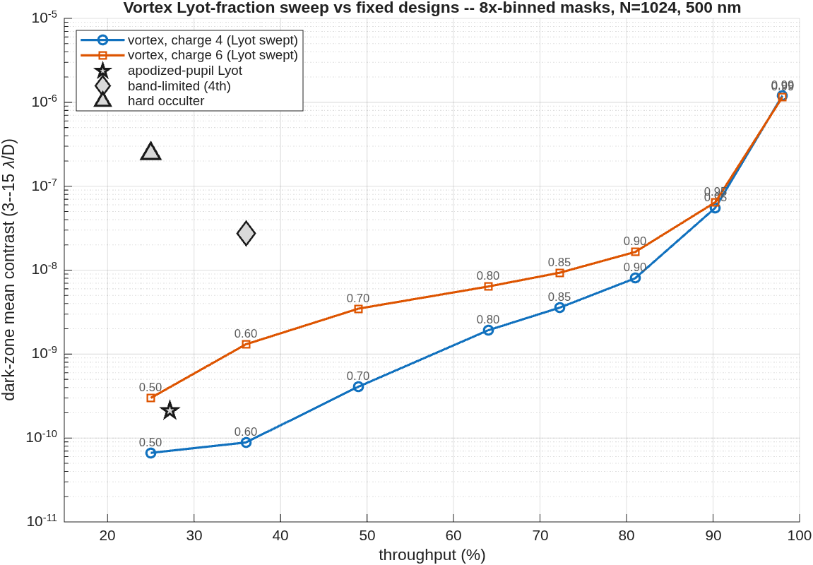{h=3.45}

## Phase-factor export | External PROPER models can consume this model's planes and check theirs against ours station by station
::: left
- One self-describing file carries the 44-element model: 18 stations (complex field, amplitude, OPD, pitch, in metres), 17 propagation legs, 4 reference spheres, 18 per-plane phase screens, with sign, orientation and centering conventions stamped inside. Orientation measured, not asserted: a +X pupil phase ramp lands the image peak where the file says.
- A companion PROPER script reads only the file, no macos, and replays the model two ways: every leg propagated, or handing off at the exported fields. Focus stations reproduce at correlation 1.000000 both ways; gated pupil planes ≥ 0.9998 replayed, ≥ 0.96 handed off.
- Rule 1, replaying a focus: start PROPER from the exported converging-sphere plane, not the mirror before it. The sphere's radius sets the focal pixel; starting at the mirror gives pixels 4.5× the wrong size.
- Rule 2, comparing between mirrors: compare intensities, not phase maps. The two codes measure phase from different baselines (a flat plane here, PROPER's internal reference beam), so identical beams show mismatched phase. Simplest: seed each PROPER stage from the exported field at that plane.
::: right
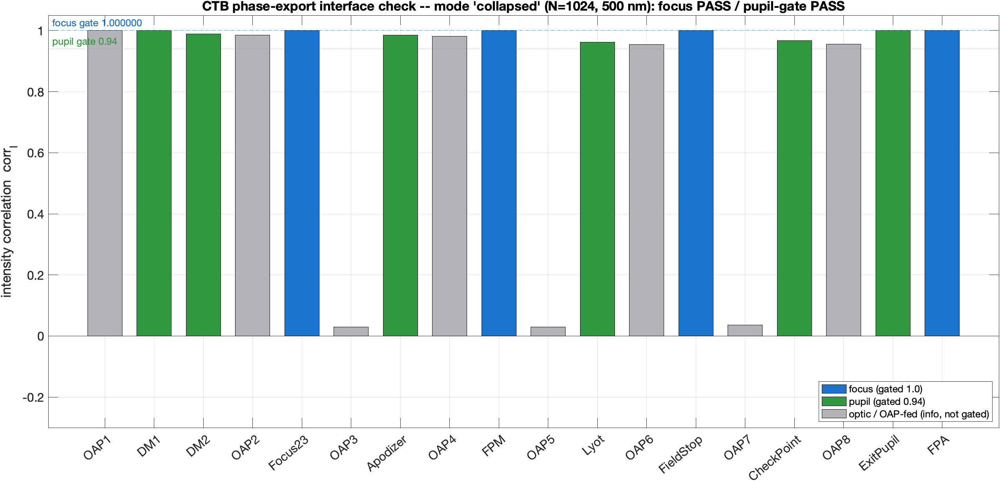{h=3.1}
~ Export ≈320 MB, kept out of git: the committed truth is an 87 KB fingerprint plus a 3 MB preview, with one-command regeneration. Single wavelength; the exported OPD is wrapped (the complex field is the primary carrier).

## External hand-off: a pure-PROPER run | From the exported data alone, PROPER reproduces the bare image exactly and forms the same dark zone
::: left
- The package: the exported model (fields, legs, spheres, per-plane screens, mask arrays, conventions stamped), a per-plane check script, and a run script that reads only the export plus PROPER. It asserts the orientation probe before any comparison.
- One continuous PROPER beam cannot reproduce this model (focal pitch ratio 0.71, correlation 0.005): the model samples every intermediate focus at the system exit-pupil Fraunhofer pitch, set by the exit-pupil sphere radii, not by each parabola's focal length, and one grid cannot carry both pitches across a focus-to-focus relay. The shipped form is one pure-PROPER script seeded from the exported fields.
- Bare image: pitch ratio 1.0000, intensity correlation 1.000000.
- Coronagraph: the PROPER cascade reaches 1.4×10⁻⁸ over 3–15 λ/D. One-sided by design: the idealized relay seeded at the apodizer omits the downstream mirror figure that scatters light in the full model, so it runs deeper than the shipped 2.9×10⁻⁷; the bound is that it lands within 2× above the shipped value.
::: right
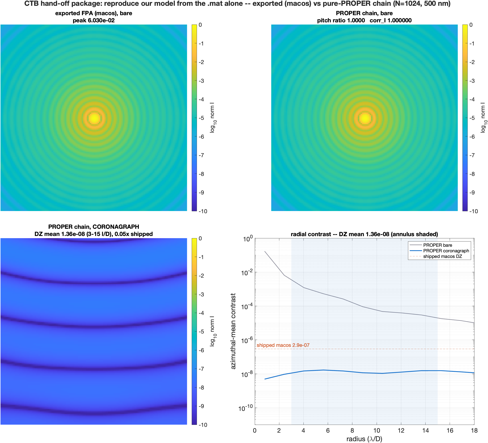{h=3.35}

## The deformable mirrors close the loop | Electric-field conjugation on the model itself: dark-zone mean 2.9×10⁻⁷ → 8.1×10⁻⁹ (36×) at 10 nm strokes
::: left
- The DMs are controllable surfaces: a 256-point displacement grid per mirror in its element frame, a 32×32 actuator lattice through Gaussian influence functions (12% nearest-neighbor coupling, 0.67 mm pitch = 21.2 mm/32; 880 actuators per DM inside the beam).
- The control matrix is measured, not modeled: every actuator poked 2 nm and propagated through the masked chain, 1760 pokes in 11 minutes. Each iteration re-propagates the model, scores the measured contrast, picks the regularization by that measurement, and stops when no step improves.
::: right
- Result: 2.9×10⁻⁷ → 8.1×10⁻⁹ (36×) in 19 iterations at 9.9/8.6 nm rms stroke.
  - The best any linear solve of the measured matrix can reach is 4.5×10⁻⁹ at 11 nm; the loop lands within 2× with one matrix measured at the flat state.
  - DM1 alone stalls at 1.3×10⁻⁷ (2.3×): the pupil mirror is phase-only; the full annulus needs the amplitude lever DM2 supplies.
- Where it works hardest: with the 50% Lyot, 32 actuators steer light to about 8 λ/D; the inner half of the zone deepens 40×, the outer 25×; the largest strokes ring the Lyot edge image on the mirror.
::: full
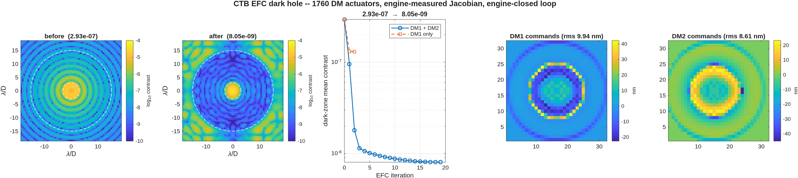{h=2.1}
~ Sensing is perfect here: the loop reads the model's complex field. The telescope slides close the loop on fields estimated from probe images, as a testbed must.

## Deeper: the loop on the vortex chain | 1.7×10⁻⁸ → 6.8×10⁻¹⁵ at half-nanometer strokes; this chain leaves nothing the mirrors cannot remove
::: left
- The same loop on the vortex configuration: charge 4, Lyot 0.60, no apodizer, at N=512 where the static floor is 1.7×10⁻⁸ (the sweep slide is N=1024).
- The first iteration removes 300×; commands never exceed ~0.5 nm rms. The residual field is so small that the measured matrix is nearly exact.
- Going deeper is one re-measurement about the corrected state (7 minutes of pokes):
  - hard-occulter chain: 2.1× more, to 3.8×10⁻⁹, consistent with its linear bound of 4.5×10⁻⁹;
  - vortex chain: another 86×, to 6.8×10⁻¹⁵.
- The reading: the hard occulter's floor is physics, occulter-edge diffraction the mirrors cannot represent. The vortex chain's floor is arithmetic, a residual field ~3×10⁻⁸ of the peak amplitude, the roundoff of double-precision propagation. A real bench stops far earlier, at sensing noise and drift.
::: right
| chain | static | fixed matrix | re-measured |
| hard occulter, Lyot 0.50 | 2.9×10⁻⁷ | 8.1×10⁻⁹ | 3.8×10⁻⁹ |
| vortex charge 4, Lyot 0.60 | 1.7×10⁻⁸ | 5.8×10⁻¹³ | 6.8×10⁻¹⁵ |
- Strokes at the floor: 9.9/8.6 nm rms (hard chain), 0.49/0.55 nm rms (vortex chain, before/after re-measurement). Dark zone 3–15 λ/D throughout.
::: full
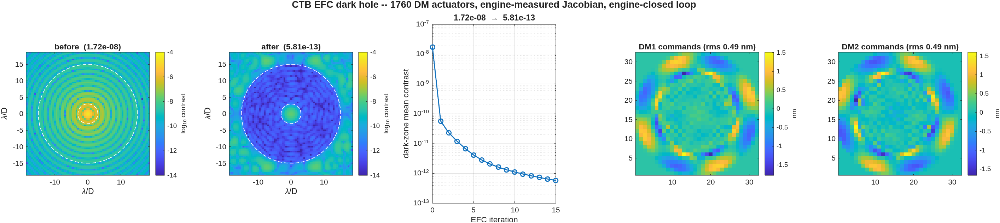{h=2.0}

## Polarization: what the mirrors do | The coated train's uncontrollable residual is 1.1×10⁻¹⁵ at every bandwidth, a state change rather than an aberration
::: left
- The model: the coated train's Jones pupil (quarter-wave MgF₂ over aluminum, all ten mirrors), ray-traced to the exit pupil and applied as per-component pupil screens. Each of the four Jones components propagates as its own scalar chain; unpolarized input is their half-weighted sum. One control matrix drives the co-polarized mean; the spread about it is the uncontrollable part.
- The maps: retardance 3.4 mrad mean with 8.7 µrad rms variation; diattenuation 6.1×10⁻⁴ mean, 1.4×10⁻⁶ variation. The mean is a state change the loop absorbs; only the variation drives a floor.
  - Closed loop 5.8×10⁻¹³, indistinguishable from the scalar result; uncontrollable part 1.1×10⁻¹⁵.
  - At these gentle incidence angles polarization does not set the floor, which is why testbeds fold gently.
- The station walk (right): the coating imprint appears at the screen plane, propagates through the vortex, and the cross-polarized light, four decades down, carries its own two-lobe pattern to the camera.
- A measurement lesson: normalize the Jones screens by the COMPLEX mean of the co-polarized element. Magnitude-only normalization leaves the global reflection phase in the screens; corrections land rotated by twice that phase and add energy (achieved-vs-predicted correlation −0.80, the cos θ signature).
::: right
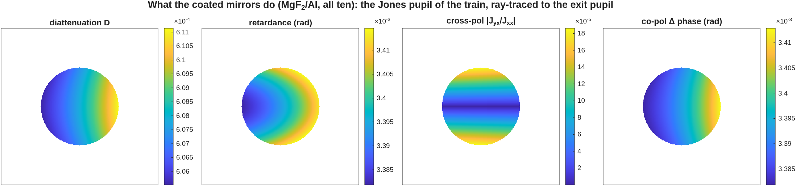{h=1.45}
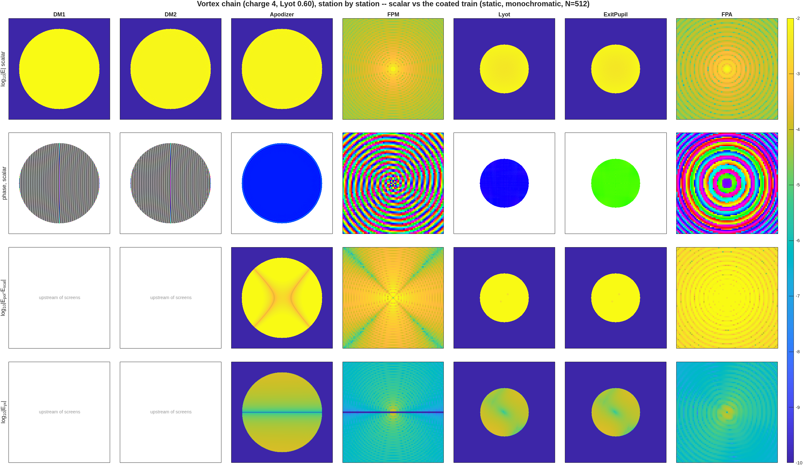{h=2.75}

## Bandwidth: the chromatic floor | Mono 8×10⁻¹³ → 5%: 9×10⁻¹² → 10%: 2.5×10⁻¹¹ → 20%: 5.4×10⁻¹¹, gentle growth once control sampling matches the band
::: left
- Per-wavelength propagation (the vortex is a pure angle map; the target is the fixed physical annulus), control wavelengths at constant 2.5% spacing: 3 colors across 5%, 5 across 10%, 9 across 20%. One matrix measured over the 9-color superset serves every band.
- The closed-loop floor:
  - 8.3×10⁻¹³ mono → 9.4×10⁻¹² at 5% → 2.5×10⁻¹¹ at 10% → 5.4×10⁻¹¹ at 20%, only 2× from 10% to 20%;
  - the polarization floor rides flat at 1.1×10⁻¹⁵ at every bandwidth;
  - re-measuring the matrix about the corrected state adds ~1.5× (2.0×10⁻¹¹ at 10%).
- Lyot rebalanced under the 10% band: 0.70 holds 6.5×10⁻¹¹ at 49% throughput, 0.80 holds 1.2×10⁻¹⁰ at 64%, every point decades below the hard-occulter chain.
::: right
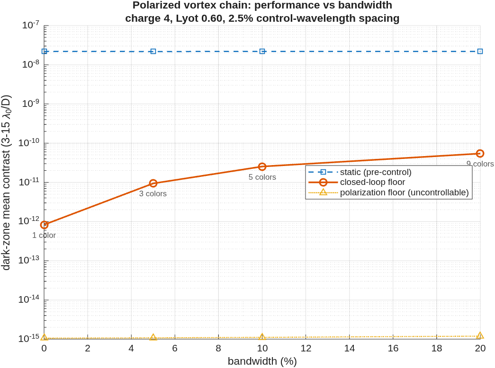{h=3.1}
::: full
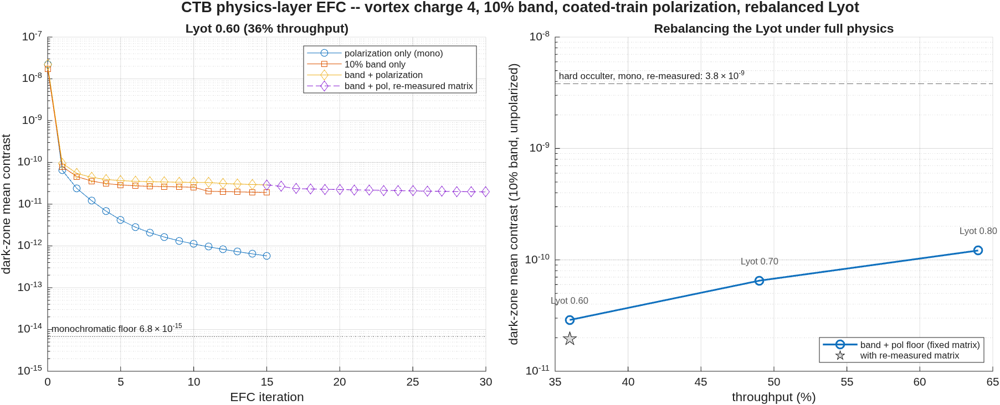{h=2.0}

## The vector vortex | The retardance leak is uncorrectable but optically removable: a circular sandwich returns to the scalar floor under per-λ control; a crossed-linear sandwich goes deeper at the price of eight planet blind spots
::: left
- A vector vortex is a rotating half-wave plate: a 2×2 Jones focal-plane mask, not a scalar screen. Downstream is linear, so each output component is the coherent sum of two chain runs (the cos mθ and sin mθ entry masks); no engine change. The ideal plate (δ=π) validates it: static equals the scalar vortex (leakage 4×10⁻³³), analyzed it reproduces the scalar floor (4.8×10⁻¹³).
- The zero-order plate leaks and no mirror can fix it: δ(λ)=πλ₀/λ leaves cos²(δ/2) of the starlight un-spiraled (10⁻³ at 5%, 10⁻² at 20%); the leak flips sign across band center, so one DM setting cannot null both halves. Unpolarized, even the ideal plate floors at 2.0×10⁻⁹ (one surface serving the ±m channels of both polarizations).
- The circular sandwich (R in, L analyzed) removes the leak optically: statics return to the mono value at every band; floors 8.3×10⁻¹³ mono → 1.5×10⁻¹⁰ at 20%. The residual above the scalar chain is control: stacking per-wavelength targets instead of a band mean recovers 265× at 5% (2.1×10⁻⁹ → 7.9×10⁻¹²), onto the scalar chain's own floor.
- A crossed linear polarizer: star-side two to three decades better. The y-analyzed channel of an x-polarized star is the sin mθ chain, an eight-octant-mask analogue: static 7×10⁻¹¹ (240× below circular), closing to 6×10⁻¹⁶ mono → 7×10⁻¹³ at 20%.
  - The price: transmission ∝ sin²(mθ_p), eight azimuthal blind spots at charge 4 where the circular sandwich is flat;
  - the coated mirrors' cross-polarization re-injects leak the analyzer cannot strip (full stack 2.2×10⁻⁹ static, 3.4×10⁻¹¹ closed and descending).
::: right
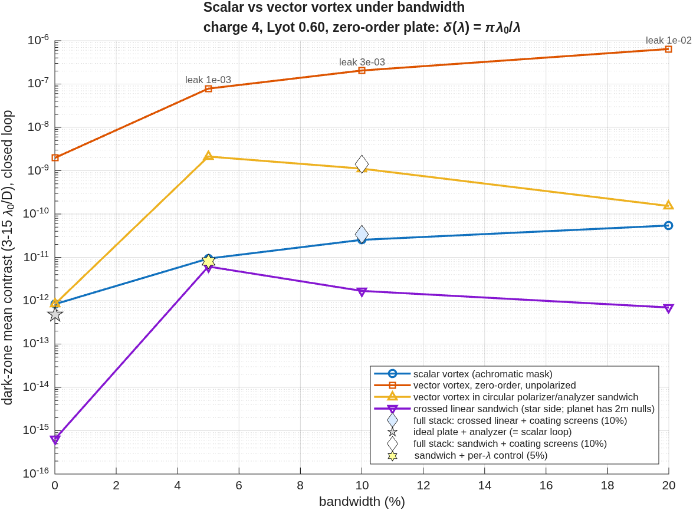{h=3.55}

## The coronagraph on a telescope | Behind a 4 m f/18 telescope, folded into its 5.0 m launch envelope, the bench's model runs unchanged; the secondary's shadow, not the wavefront, sets the static dark zone at 5.8×10⁻⁶
::: left
- The train: the CTB behind the end-to-end thread's telescope (mmacos manual chapter 2), OAP1 matched to it (f = f/# × 21.4 mm), DM1 at the image of the telescope's stop, the chain folded into the 5.0 m envelope by one 4° fold on the converging feed with the accordion stood up in the vertical plane (stage 8):
  - 0.23 m inside the envelope, 160 mm from every telescope body and beam, 31 mm from itself, every surface at 5° or less;
  - the same rays and wavefront as the unfolded chain.
- The diffraction model (stage 9): the bench's generator inserts the three mask quartets, the DM1→DM2 leg and the far-field terminal behind the nine telescope elements, every reference sphere found through the whole train: 40 elements (53 full).
  - Chief ray at every optic within 10⁻¹³ mm of the bare train; point image on the centre pixel; mask blocks transparent to 2×10⁻¹⁵ with no mask.
  - The masked chain, DM layer, control matrix and loop run as on the bench, given the deck and its station map.
- What limits it: not the wavefront (0.0024 waves rms on DM1; flattening it with 0.9 nm rms changes nothing). Without the secondary's obscuration the deck sits at 2.4×10⁻⁷, below the bench's 2.9×10⁻⁷. With it, 5.8×10⁻⁶: the shadow is 0.4% of the pupil, and the occulter throws its diffraction into the Lyot plane around the shadow's image, where a plain disk stop passes it.
- Model limit, on record: the beam is 4% anamorphic (f/17.7 × f/18.5) but the engine carries the field on one lattice spacing, so the point image is round; scaling the occulter by that ratio moves the static number 5.9–6.1×10⁻⁶.
::: right
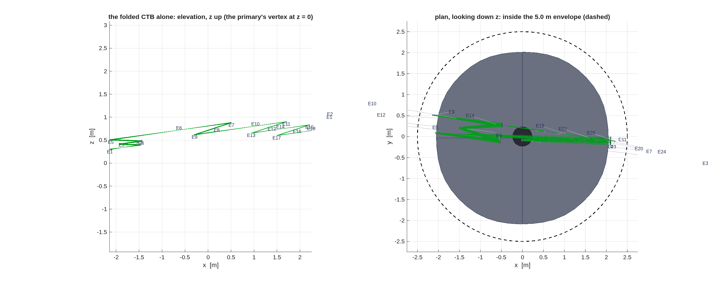{h=2.0}
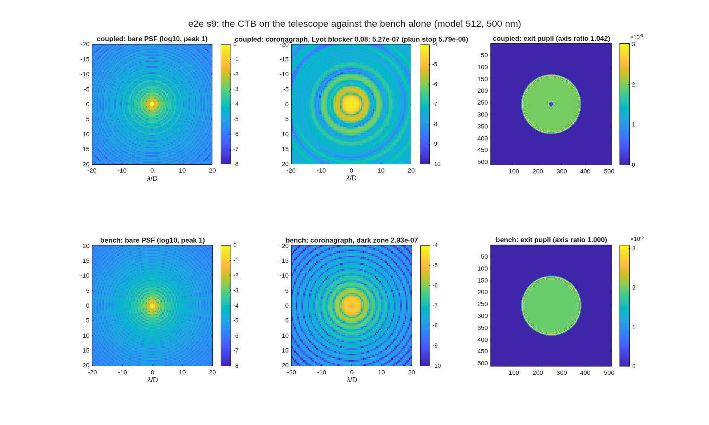{h=3.2}

## Views of the folded instrument | The whole train from the side and in isometric view, the bench on the primary's back, and the folded bench alone
::: full
{h=5.4}
- Nine telescope elements, then the bench's seventeen; one added fold F0 at 4°, 0.23 m before the telescope focus; the accordion stands in the vertical plane on the primary's back, under the returning beam.

## The fit in the shroud | Every body of the folded instrument projected along the optical axis: a 4.509 m hardware union inside the 5.0 m gate
::: left
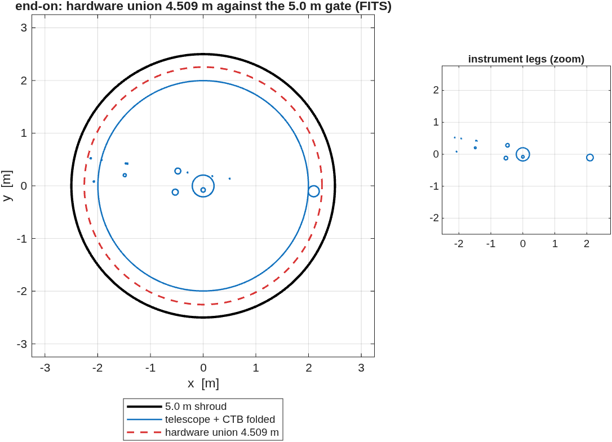{h=4.2}
::: right
- The gate: a 5.0 m launch envelope around the 4 m primary; the folded train's hardware union is 4.509 m across, 0.23 m inside it.
- Clearances measured by the fold stage: 160 mm from every telescope body and beam, 31 mm within the bench itself, every surface at 5° incidence or less.
- The fold costs nothing optically: the same rays and wavefront as the unfolded chain, the camera's point image on the centre pixel.

## The field through the train | Log amplitude and phase at eight planes, from the primary to the camera, static with the annular Lyot
::: full
![ctb_e2e_figures: the field at the primary M1, DM1 (the stop image, where the diffraction chain starts), DM2, the apodizer, the focal-plane mask (after the occulter), the Lyot stop (after the annular stop), the exit pupil and the camera; top row log₁₀ amplitude over six decades; bottom row the phase: at the pupil planes from DM1 on the ray-traced wavefront in waves (chief-ray reference, piston and tilt removed, the rms printed), at the focal planes the propagated field's phase; the primary is a ray-traced plane. Flat mirrors, blocker 0.08, N=512, 500 nm.](ctb_e2e_walk.png){h=3.0}
- Pupil planes carry the secondary's shadow through the train; the annular stop's inner blocker covers the shadow's image at the Lyot plane and the exit pupil.
- Focal planes: the occulted core at the mask, the dark zone at the camera, 5.3×10⁻⁷ mean over 3–15 λ/D at this static state, the number stage 9 reports.
- The wavefront row is the beam's traced phase at each pupil, piston and tilt removed: 0.92 waves rms of the relay's own astigmatism at DM1 and DM2, cancelled by the apodizer plane (0.0024 waves rms there and at the Lyot and exit pupil, the telescope's figure). The field's own phase on the grid carries the propagation frame's tilt and curvature, so it is shown only at the focal planes.

## The loop on the telescope | A central Lyot blocker of 0.08 pupil radii takes the shadow's diffraction (5.8×10⁻⁶ → 5.3×10⁻⁷ at 97% of the stop's throughput); the mirrors dig from there to 6.9×10⁻⁸, eight times, where the bench alone digs thirty-six
::: full
- The stop against the shadow: an annular Lyot (the bench's 0.50 disk with a central blocker), scanned over the blocker radius:
  - 0.08 → 5.3×10⁻⁷ (97% throughput); 0.12 → 6.3×10⁻⁷; 0.16 → 7.0×10⁻⁷; 0.20 → 6.9×10⁻⁷ (84%);
  - the smallest blocker covering the shadow's image is the best; the curve is not monotonic because the blocker's own edge diffracts.
- The loop: the control matrix measured on the telescope chain with the annular stop (1760 actuators, two pokes each, 70 min):
  - 5.3×10⁻⁷ → 1.4×10⁻⁷ in 6 iterations at 7.6/6.0 nm rms;
  - re-measured about that state (72 min): → 6.9×10⁻⁸ in 9 more at 8.4/8.2 nm;
  - eight times overall against the bench's thirty-six (2.9×10⁻⁷ → 8.1×10⁻⁹, 3.8×10⁻⁹ relinearized).
- What remains is the shadow's diffraction outside the blocker: an amplitude hole at the pupil's centre that the mirrors fill only with strokes past their linear range. The regularization grid's proposed step on the brighter halo asks DM2's edge actuators for strokes outside that range, so the grid runs a decade further and the loop takes smaller steps.
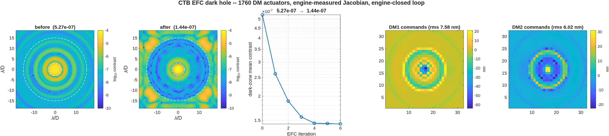{h=2.1}

## Sensing the field on the telescope | Pairwise probing on the telescope's 5.3×10⁻⁷ halo: the bench's default probe (37 nm) reads the field 31% off, a 0.3× probe reads it to 2.8%, and the estimate needs a control matrix measured about the current state
::: left
- The probes: three pairs of ±sinc probes on DM1, fields predicted from the control matrix; the estimator (Give'on, Kern & Shaklan 2011) solves each pixel's field from the pair differences.
  - The default amplitude rule (probe intensity = speckle level) gives 37 nm, 0.94 rad, twenty times the bench's; the probe's second-order response leaves the estimate 31% off.
  - The error falls as the amplitude squared: 0.3× (11 nm) reads it to 2.8%, 0.1× to 0.3%.
- Two bench diagnostics that do not transfer:
  - the probe-intensity ratio reads 1.20 at every amplitude here (1.02 on the bench): the second-order field cancels in the pair difference and survives in the sum, so on a bright halo it flags a gross mismatch only;
  - the estimate wants the matrix about the current state: at the dug state (6.9×10⁻⁸) the flat-state matrix estimates the field 24% off, the matrix about its own point 0.8%.
- The loop on estimates: matrix held fixed, 5.3×10⁻⁷ → 1.7×10⁻⁷ in four iterations, 1.20× perfect sensing's 1.4×10⁻⁷; re-measured on the estimate, → 7.6×10⁻⁸ against 6.9×10⁻⁸. The line search scores the measured contrast, so a wrong estimate costs depth, never stability.
- Photons: 10¹⁰ per image at the bare peak costs 10% error at the 0.3× probe; 10⁸ (fifty per speckle pixel) leaves no linear probe usable.
::: right
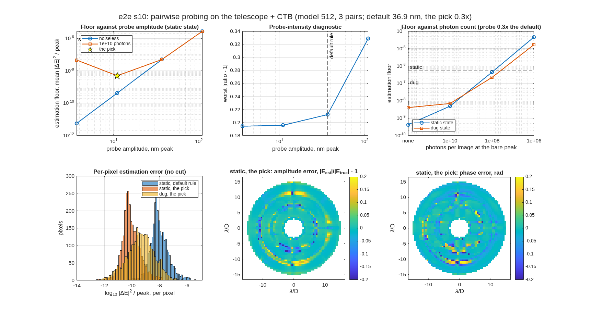{h=4.2}

## Recompute-and-restart cycles to 10⁻¹⁰ | Measuring the control matrix about the loop's own state and restarting takes the telescope's dark zone to the 10⁻¹⁰ goal: perfect sensing in 7 cycles (115 iterations, 7.3×10⁻¹¹), probe estimates in 9 (149 iterations, 6.2×10⁻¹¹), the estimate under 1% of the field at every matrix measured about the state
::: left
- The procedure, standard practice for driving contrast down: measure the matrix about the state (3520 chain runs, 57–73 min each), run the loop until no step improves or 20 iterations, measure again from where it ended; stop at the goal 10⁻¹⁰, at a cycle gaining under 5%, or at twenty cycles. Resumable from a state file; thirteen matrices measured.
- Both chains reach the goal:
  - perfect sensing: 5.3×10⁻⁷ → 1.4×10⁻⁷ → 6.9×10⁻⁸ → 2.9×10⁻⁸ → 8.7×10⁻¹⁰ → 3.1×10⁻¹⁰ → 1.5×10⁻¹⁰ → 7.3×10⁻¹¹, one cycle alone 33×;
  - probe estimates: → 1.7×10⁻⁷ → 7.4×10⁻⁸ → 4.3×10⁻⁸ → 5.1×10⁻⁹ → 9.6×10⁻¹⁰ → 3.9×10⁻¹⁰ → 2.0×10⁻¹⁰ → 1.1×10⁻¹⁰ → 6.2×10⁻¹¹, two cycles more, the allowance;
  - below 10⁻⁹ every cycle of either chain runs to its 20-iteration cap gaining about 2×: the last decade costs cycles, not sensing;
  - strokes under 13 nm rms on both mirrors throughout.
- The estimate holds at depth: 2.8% of the field at the first matrix (measured at the flat mirrors), 0.8% and under at every matrix measured about the loop's own state, 0.1% at the last. It improves as the field dims, as the probe's second-order term predicts.
- The stage's first run, on the engine's bilinear grid surfaces, lost it at the fifth matrix (17% off): a ray crossing a cell edge under a sub-nanometre probe took the cells' slope difference as a kink. The mirrors' grids now interpolate with continuous slope (GridSrfOrder= 3); these records are measured on it.
::: right
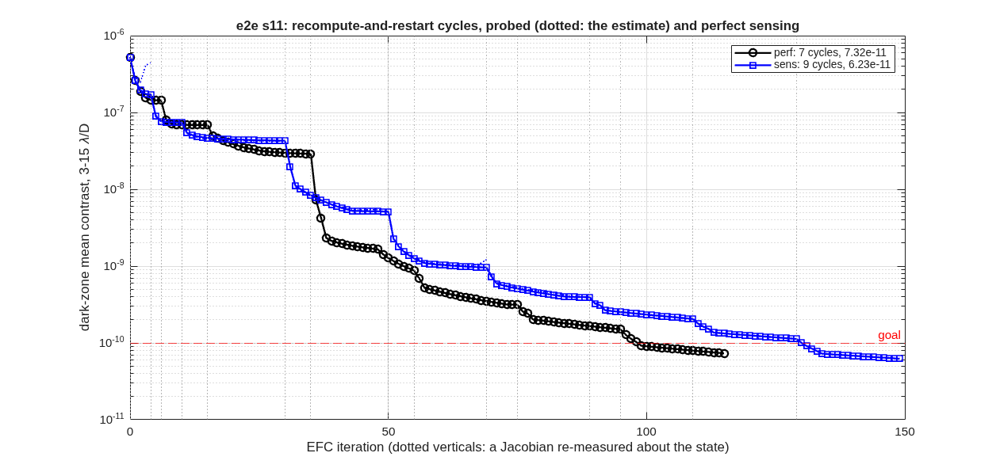{h=4.2}

## Next | Towards a real coronagraph model...
::: full
- Sensing at depth. The probe estimate is the lab's view of the field, held to 1% at depth; the model's beam needs the anamorphic lattice (a resampling of the field at the first diffraction plane, an engine change). FALCO, the community's standard wavefront-control software, can then drive the same DMs from the same images (the hybrid Lyot mask enters there, since its design comes from that control loop).
- Aberrations and drifts. As-built mirror surface maps (measured-quality power spectra), then alignment drifts as a time series against the delivered control loop: dark-zone maintenance, and how long the hole survives between corrections.
- Validation against testbed data, the capstone. Needs a named dataset from a real bench and the measured (not design) parameters that produced it.
~ Mechanical layer delivered and merged: a prescription generator reproducing both hand-built models to round-off, regression tests pinning the validated numbers (two suites, 16 checks green), the example README, and the exit-pupil-finder guard in the engine.
~ Everything from the loop slides through the vector vortex is reconstructible at other parameters with one call, ctb_study (backup); the telescope slides with the thread's stages 8 to 11.

## References | Sources for the mask families, the control method and the estimator; every formula taken from the paper itself
::: full
- Band-limited masks: Kuchner & Traub 2002, ApJ 570, 900 (4th order); Kuchner, Crepp & Ge 2005, ApJ 628, 466 (8th order).
- Apodized-pupil Lyot: Soummer 2005, ApJ 618, L161 (the prolate apodizer); Soummer et al. 2011, ApJ 729, 144 (the GPI configuration used here).
- Phase masks: Roddier & Roddier 1997, PASP 109, 815 (the π-spot); N'Diaye et al. 2012, A&A 538, A55 (the achromatic dual-zone); Soummer, Dohlen & Aime 2003, A&A 403, 369.
- Vortex: Mawet et al. 2005, ApJ 633, 1191; Foo, Palacios & Swartzlander 2005, Opt. Lett. 30, 3308; Jenkins 2008, MNRAS 384, 515 (the even-charge rejection property).
- Vector vortex: Mawet et al. 2009, Opt. Express 17, 1902 (the liquid-crystal-polymer VVC and its retardance-leakage term); Mawet et al. 2010, ApJ 709, 53 (laboratory results). The 2×2 Jones form is the standard rotating-half-wave-plate algebra, re-derived in the driver's help text.
- Wavefront control: Give'on et al. 2007, Proc. SPIE 6691 (electric-field conjugation, the correction solve).
- Focal-plane sensing: Give'on, Kern & Shaklan 2011, Proc. SPIE 8151 (pair-wise probing, the estimator of the telescope slides).
- Diffraction reference code: PROPER, Krist 2007, Proc. SPIE 6675 (the arbiter for every propagation cross-check in this deck).
~ A companion three-slide deck (ctb_mask_families, committed beside the drivers) carries the code map: which script builds which mask, and the parameters a user can change.

## Backup Slides |
::: full
- Galleries, per-family detail, the per-leg replay check, the control-loop diagnostics, and how to reconstruct the study at other parameters.

## The mask families, one by one (1 of 2) | Apodized-pupil Lyot and band-limited
::: left
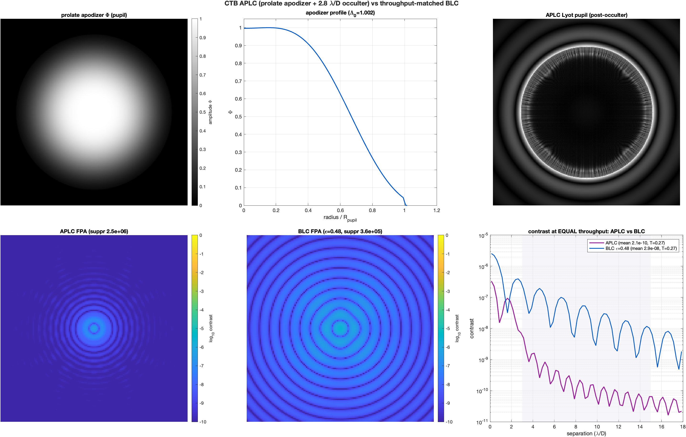{h=3.1}
::: right
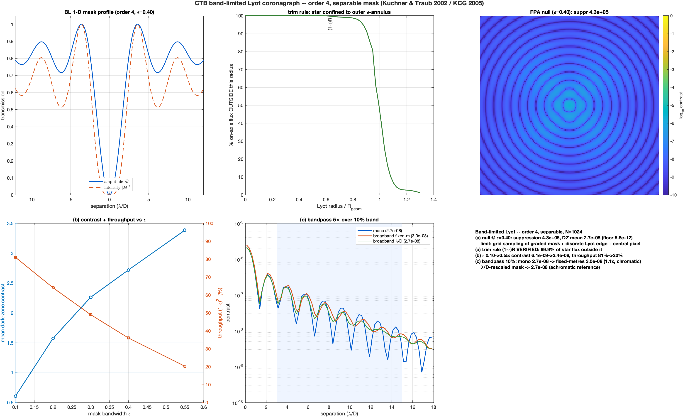{h=3.1}

## The mask families, one by one (2 of 2) | Phase masks and the vortex
::: left
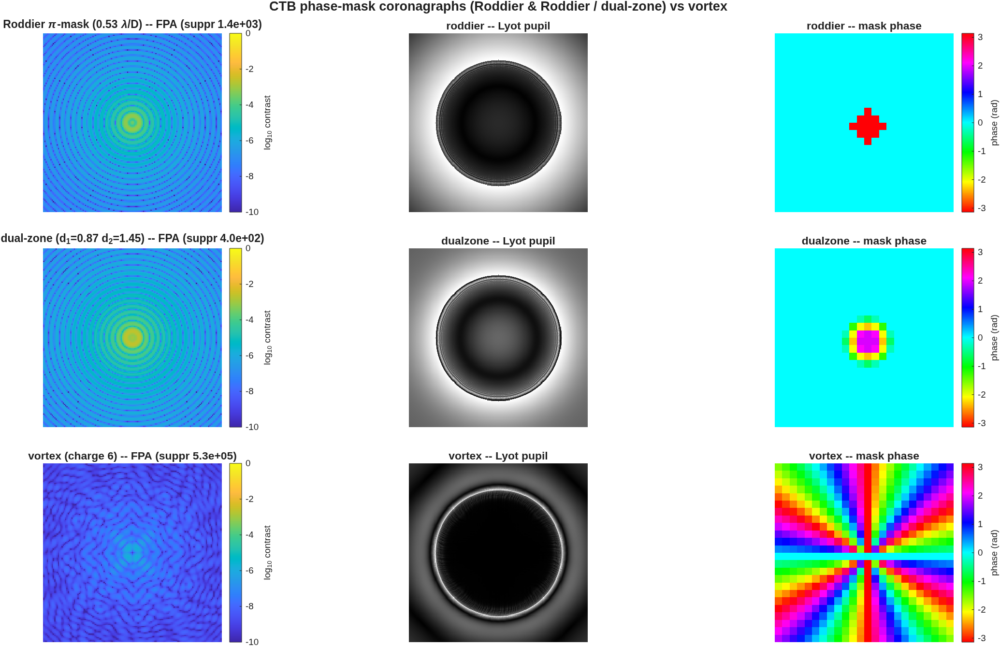{h=3.1}
::: right
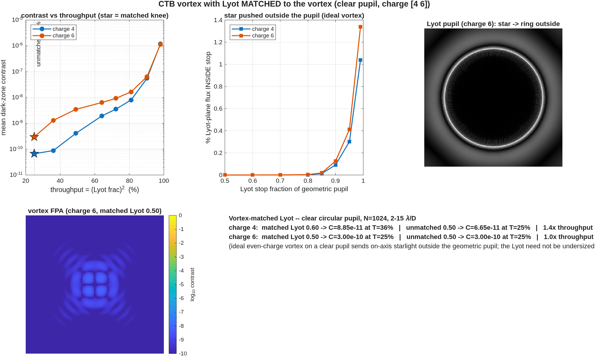{h=3.1}

## The vortex core: sampling set the floor | An ideal-pupil probe with no bench reproduces the shipped 2.9×10⁻⁷, and pixel-averaging removes it
::: left
- The probe: the same sampled charge-6 vortex in a pure Fourier chain on an ideal clear pupil (N=1024, 4 px per λ/D, Lyot 0.90), no bench optics. Direct-sampled: 3.0×10⁻⁷, matching the shipped bench number; supersampling the pupil edge changes nothing. The floor is the mask's singular core: near the axis the phase wraps faster than the grid, and the mis-phased pixels on the stellar peak scatter ~0.2% of the starlight back inside the Lyot.
- Generate-at-K× and complex-bin cancels the core phasors (transmission 0 at the core pixel, a ~1-px taper):
  - 4× gives 3.4×10⁻⁹, 8× gives 3.0×10⁻⁹ (converged);
  - an explicit 1 λ/D opaque core dot is worse, 9.8×10⁻⁹ (its own edge diffracts);
  - charge 2 is the counterexample: the medicine is for even charge ≥ 4.
- On the bench (8×-binned, charge 6, Lyot 0.90): 1.4×10⁻⁸; the remaining gap to the ideal-pupil 3.0×10⁻⁹ is the bench's own residual.
::: right
- With the core fixed, flux inside the stop is 0.0–0.1% out to a 0.90 fraction (the analytic "all starlight outside the pupil" property), and the Lyot fraction becomes a genuine depth-for-throughput trade:

| Lyot fraction | charge 4 | charge 6 | throughput |
| 0.50 | 6.6×10⁻¹¹ | 3.0×10⁻¹⁰ | 25% |
| 0.80 | 1.9×10⁻⁹ | 6.4×10⁻⁹ | 64% |
| 0.90 | 8.0×10⁻⁹ | 1.6×10⁻⁸ | 81% |
- Charge 4 at a 0.80 stop dominates the band-limited mask in depth and throughput; at 0.50 it reaches the apodized-pupil Lyot's class.

## Bare-optics agreement, and the bench | The two prescriptions before any mask, and the geometric layout they share
::: left
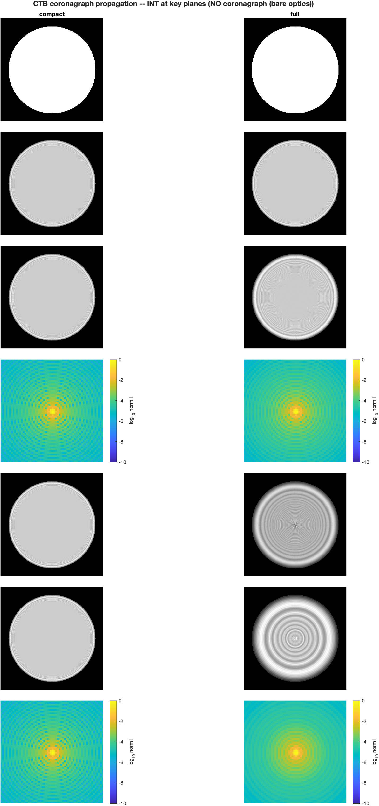{h=3.3}
::: right
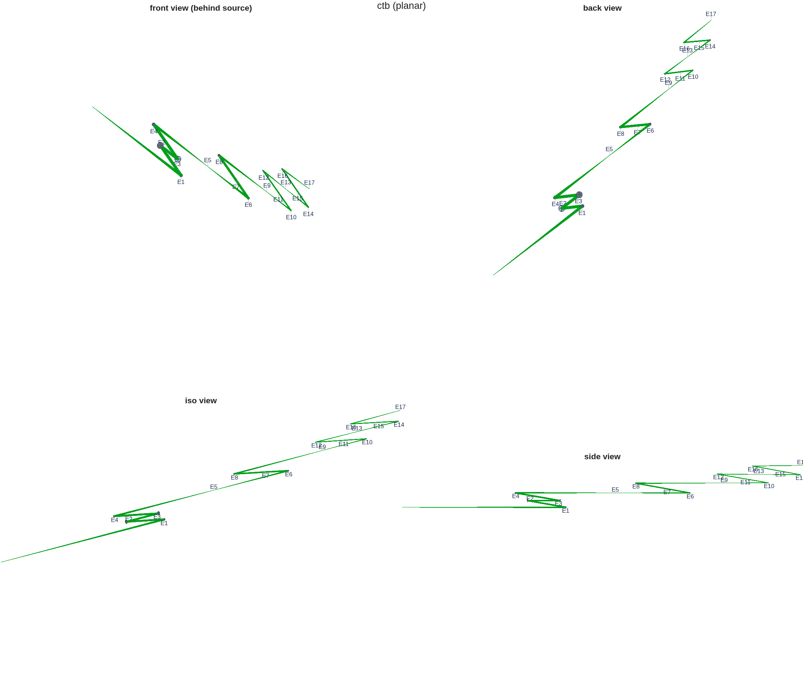{h=3.0}

## Per-leg replay check | Every station reproduced when each leg starts from the exported field
::: full
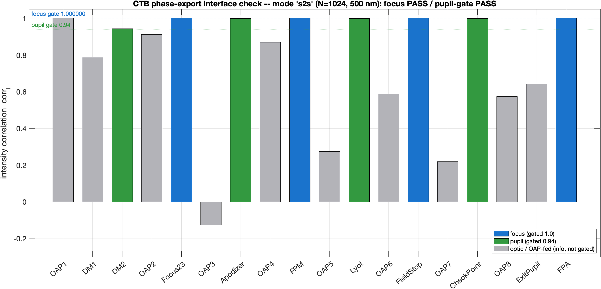{h=3.4}

## Control-loop diagnostics | Two silent failure modes, found and pinned by regression tests
::: full
- Commands are real numbers. The correction solve must treat the real and imaginary parts of the field as separate equations; a complex solve returns complex commands whose imaginary half the MATLAB-to-engine interface silently discards. The symptom is quiet: the loop improves but crawls at 3% per iteration, the achieved field nearly uncorrelated with the prediction (0.13). In the split form the same loop digs 16× in two iterations. The DM model now rejects complex commands.
- Pupil wavefront maps must be read at the exit pupil. Read at the camera (the default), a DM bump smears into a smooth error ten times its physical size, which looks exactly like a surface-amplitude bug and is not. At the exit pupil the response is 2·cos(incidence) times the commanded surface within 2%, at the commanded position to a pixel, with mirror symmetry exact.
- The validation ladder under the loop, all pinned by the regression suite: commanded surface read back bit-exact; two-poke superposition to 1 part in 10¹²; the propagation chain bit-repeatable run to run; poke response step-size-independent to 5%.

## Reconstructing the study | One config, one call: ctb_study derives every stage, tag, cache and figure
::: full
- The loop-through-vector-vortex sequence is one driver: `ctb_study()` audits or re-runs the shipped configuration; name-value overrides (mask kind, charge, Lyot fraction, band ladder) re-run it at a new parameter point. 25 steps in dependency order: Jacobian → control loop → relinearization → physics (polarization / band / both) → bandwidth sweep → the 14-run vector-vortex ladder → verdict figure. About 7.6 hours of engine time from scratch at model 512.
- Every tag, cache file and figure derives from the config. The shipped configuration maps to the historical file names; any other gets an automatic suffix (charge 6, Lyot 0.70 → `_vc6L070`), so parameter points never collide. `'dry'` prints the call plan and cost without touching the engine.
- Resumable: a stage whose run state exists is skipped and its numbers fold into the manifest; the default run over complete states costs seconds and returns the audit table reproducing every number of those slides (run at build time for this deck: 24 states verified, all floors matched).
- The guard that makes cache reuse safe: Jacobian files are keyed by name, and a name cannot encode the full mask geometry, so a stale matrix fights the loop with plausible numbers. Every cache carries a `chain_opts` stamp of the chain it was measured on, and `ctb_jac_check` refuses any load whose stamp mismatches, naming the differing fields.
